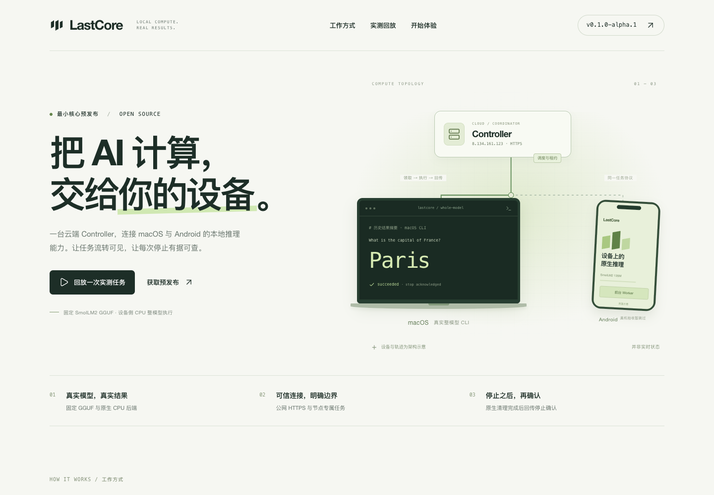

# LastCore

LastCore 面向多类型边缘设备计算网络，将设备接入统一的 AI 任务调度服务，探索利用闲置算力执行推理。Mac 与 Android 是当前已实现的接入路径，其他边缘设备适配正在开发；本次交付未提供这些适配的具体设备清单和实测证据。当前提供两条独立执行路径：**tiny 模型的连续分层推理原型**，以及**固定 SmolLM2 模型在选定单设备上的完整推理**。

技术栈：Python 3.12+、FastAPI、SQLite、NumPy/TCP、llama.cpp，以及 Android Java/JNI。项目业务时间统一使用 `Asia/Shanghai`；协议存储可使用 UTC。

## Demo 与实际截图

公开展示地址：[LastCore Demo](https://8.134.161.123/demo/)。该地址与统一 ZIP 镜像的可达性、内容和摘要由最后交付验收核对。也可直接打开 [离线展示页面](demo/offline.html)，按[三分钟讲稿](demo/DEMO-SCRIPT-3MIN.txt)展示；页面提供历史结果回放、下载和公开证据入口，不创建新的模型任务。

[5 张实际截图及采集范围](screenshots/README.md)包含桌面网页、历史回放、移动浏览器，以及线上 Swagger 和健康响应。设备画面为架构示意，移动截图不是 Android 真机证明。



## 当前功能与验证范围

| 功能 | 实现状态 | 验证与限制 |
| --- | --- | --- |
| 节点注册、独立凭据、心跳与状态管理 | 已实现 | Controller 与 Agent 测试覆盖；节点断线不会自动迁移任务 |
| 按内存与计算权重分配连续模型层 | 已实现 | 所有层完整覆盖且不重叠；内存按层估算，算力由节点上报 |
| Agent 轮询、去重、状态上报和本地停止 | 已实现 | 支持取消、超时、心跳断链；实际停止依赖节点遵守协议 |
| tiny 分层推理与 activation 逐跳传输 | 已实现 | 有本机双节点进程与单机逐字节一致验证；不是预训练大模型跨设备推理 |
| 固定 SmolLM2-135M 整模型生成 | 已实现 | 固定 GGUF、后端和 SHA256；每个任务在一个选定 worker 上执行 |
| 整模型任务结果、幂等、租约与停止确认 | 已实现 | 独立 `/v1/inference` API，默认关闭；与 legacy `/v1/tasks` 分开 |
| macOS 整模型工作节点 | 已实现，CLI 入口；恢复修复已合入 | 既有云任务证据与修复后本地真实模型证据分别保留；冻结 macOS bundle 服务 tiny 路径 |
| Android 前台 UI、工作节点与 JNI 后端 | 已实现，真机未验收 | 有 APK 构建与主机 JVM/JNI 证据；不代表 Android 真机、Keystore 或生命周期已验证 |
| SQLite 诊断、在线备份、恢复及部署归档 | 已实现 | 保留数据与凭据的验收范围见发布记录 |
| 预训练大模型跨设备分层、KV cache/batching、NAT 穿透、离线自动迁移 | 未实现 | 不作为当前可交付功能 |
| 其他类型边缘设备适配 | 开发中 | 用户确认的后续开发范围；具体设备与支持状态以实际源码和验收材料为准 |
| 生产客户端签名、公证与 Windows 发布 | 未交付 | Android debug 为开发签名，release APK 未签名；macOS bundle 未签名/未公证 |

已有公开版本为 [v0.1.0-alpha.1](https://github.com/7onytang/LastCore/releases/tag/v0.1.0-alpha.1)，固定源码 `85ddad9`，其树与 main 的整合提交 `2e8c76b` 一致。[验收记录](submission/evidence/ACCEPTANCE.txt)和[来源说明](submission/evidence/README.md)记录该版本的验证范围；本次文档整理未重新执行其中的模型或部署验收。最终参赛版本须在项目完成后再次固定。

Mac worker 的三处恢复/凭据修复已通过 [PR #59](https://github.com/7onytang/LastCore/pull/59) 合入，修复源提交为 `30b9efc`，核心合并提交为 `7a9cd49`：注册被明确拒绝后允许纠正并重试、节点凭据绑定原 Controller origin、已停止任务的恢复上报先于模型文件检查。相关测试共 23 项通过（含 8 项新增回归），本地真实 HTTP Controller 的三个恢复场景及一次真实固定 GGUF 任务也通过。依据见[独立复核记录](submission/evidence/mac-worker-30b9efc-review.md)、[本地模型证据](submission/evidence/mac-worker-30b9efc-local.json)和[回归测试](real-model-runtime/tests/test_worker_recovery.py)。自动 CI 通过；手动 `real-model-smoke` 为跳过，真实模型依据来自上述本地验收。

上述修复后验收是本地测试，不代表新的云端模型运行或 Android 真机验证；云端 Controller 仍沿用原 Alpha 源码。**旧版无 origin 的 worker 凭据需先独立确认原服务器地址，再按[显式迁移说明](real-model-runtime/README.md#worker-credential-and-recovery-corrections)离线绑定**，不能删除状态目录或盲目绑定当前地址来绕过恢复。最终参赛提交与展示材料仍待项目完成后统一固定。

**两种任务的结果语义不同：** legacy `/v1/tasks` 完成表示各分片上报完成，Controller 不存储该路径的模型输出；整模型 `/v1/inference/jobs` 保存有界文本结果和停止确认。单设备 SmolLM2 成功不能证明真实预训练模型已跨设备分层。

## 评分依据与评审入口

以下按赛事六个维度提供具体文件，供评审核验，不作自评分。优先展示可运行的功能和使用路径，验证范围见各证据原文。

| 维度 / 分值 | 可核验内容 | 具体文件 |
| --- | --- | --- |
| 完成度 / 25 | tiny 分层闭环；真实整模型结果与停止确认；修复后本地恢复和真实模型验收 | [双节点脚本](integration/run_two_node_local.sh)、[Alpha 验收](submission/evidence/ACCEPTANCE.txt)、[修复后本地证据](submission/evidence/mac-worker-30b9efc-local.json) |
| 实用性 / 20 | 本地生成、工作节点安装、固定模型校验、旧凭据迁移 | [当前 CLI 指南](real-model-runtime/README.md)、[Android 指南](android-app/README.md)、[tiny bundle 指南](node-agent/desktop/README.md) |
| 创新性 / 15 | 资源约束下连续分层与逐跳 activation；整模型任务的结果和停止收敛 | [scheduler.py](controller-server/app/scheduler.py)、[pipeline.py](inference-engine/inference_engine/pipeline.py)、[任务协议](controller-server/REAL_JOBS.md)；不宣称算法首创或预训练模型跨设备已完成 |
| 代码实现 / 15 | 恢复/凭据边界回归、事务及容量扩展、固定 Git 归档检查 | [恢复测试](real-model-runtime/tests/test_worker_recovery.py)、[容量测试](controller-server/tests/test_capacity_expiry_scaling.py)、[真实 Git 归档测试](ops/staging/tests/test_prepare_release.py) |
| 项目架构 / 15 | 控制面与执行面分离、两种任务协议隔离、执行所有权与停止确认 | [Node Agent 协议](node-agent/PROTOCOL.md)、[通信协议](communication/PROTOCOL.md)、[整模型 API](controller-server/REAL_JOBS.md)、[guardian](real-model-runtime/job_guardian.py) |
| 展示效果 / 10 | 实际运行的桌面/移动网页、交互回放、线上 Swagger 与健康响应 | [Demo 源码](demo/index.html)、[5 张实际截图及范围](screenshots/README.md)、[三分钟讲稿](demo/DEMO-SCRIPT-3MIN.txt) |

完整材料核对见 [submission/README.md](submission/README.md)。健康响应只证明采集时可达；回放是历史结果说明，移动浏览器截图不是 Android 真机验收。

## 核心文件清单

| 模块 | 核心文件 | 职责 |
| --- | --- | --- |
| Controller | [main.py](controller-server/app/main.py)、[store.py](controller-server/app/store.py)、[scheduler.py](controller-server/app/scheduler.py) | API、鉴权、持久化、预留与连续分层调度 |
| 整模型任务 | [inference_jobs.py](controller-server/app/inference_jobs.py)、[REAL_JOBS.md](controller-server/REAL_JOBS.md) | 整模型协议、幂等、租约、结果及清理屏障 |
| Node Agent | [agent.py](node-agent/lastcore_node_agent/agent.py)、[executor.py](node-agent/lastcore_node_agent/executor.py)、[inference_adapter.py](node-agent/lastcore_node_agent/inference_adapter.py) | 节点生命周期、任务领取和引擎执行 |
| tiny 引擎 | [model.py](inference-engine/inference_engine/model.py)、[stage.py](inference-engine/inference_engine/stage.py)、[pipeline.py](inference-engine/inference_engine/pipeline.py) | 模型前向、分段执行与链路编排 |
| 通信 | [channel.py](communication/communication/channel.py)、[protocol.py](communication/communication/protocol.py) | TCP 帧、tensor 编解码、取消与超时 |
| 真实模型运行时 | [bootstrap.py](real-model-runtime/bootstrap.py)、[runtime.py](real-model-runtime/runtime.py)、[worker.py](real-model-runtime/worker.py)、[job_guardian.py](real-model-runtime/job_guardian.py) | 固定模型准备、本机生成、云任务与进程监管 |
| Android | [MainActivity.java](android-app/app/src/main/java/ai/lastcore/android/MainActivity.java)、[CloudWorker.java](android-app/app/src/main/java/ai/lastcore/android/CloudWorker.java)、[local_runtime.cpp](android-app/app/src/main/cpp/local_runtime.cpp) | 前台界面、工作节点与 JNI 推理入口 |
| 运维与验证 | [backup.py](controller-server/app/backup.py)、[diagnostics.py](controller-server/app/diagnostics.py)、[双节点脚本](integration/run_two_node_local.sh)、[归档工具](ops/staging/prepare_release.py) | 备份、诊断、真实本机 tiny 链路与固定提交打包 |

架构：客户端/Agent 经 HTTP(S) 接入 Controller；Controller 使用 SQLite 管理节点与任务。tiny 路径由首段到末段逐跳传输 activation；整模型路径由指定 worker 领取任务、调用本地 llama.cpp 并回报文本，两条路径的预留互斥。详细约定见 [Node Agent 协议](node-agent/PROTOCOL.md)、[通信协议](communication/PROTOCOL.md)与[整模型 API](controller-server/REAL_JOBS.md)。

## 安装、运行与验证入口

| 目标 | 说明 |
| --- | --- |
| 启动本地 Controller | 按下方“本地运行”，访问 `http://127.0.0.1:8000/docs` |
| 运行 tiny 双节点链路 | 按下方“Integrated candidate verification and staging”安装模块依赖并运行集成脚本 |
| 本机真实文本生成 / macOS worker | [real-model-runtime/README.md](real-model-runtime/README.md) |
| macOS tiny bundle | [node-agent/desktop/README.md](node-agent/desktop/README.md) |
| Android 构建和安装 | [android-app/README.md](android-app/README.md)；真机验收仍待完成 |
| Docker 与 HTTPS 部署 | 下方“Docker 部署”及 [HTTPS 运维说明](ops/public-ip-https/README.md) |

各模块 README 提供安装和验证命令。凭据只在本机私有配置中填写，不提交仓库。既有版本安装步骤见 [QUICKSTART.txt](submission/evidence/QUICKSTART.txt)。

## 参赛材料

队伍名：**Tibo重置了吗**。提交截止：**2026 年 10 月 13 日 18:00（北京时间）**。赛题全称、官方开赛时间尚待确认。材料按已提供的提交要求和评分维度组织，不自拟官方模板或等级标准。

- [提交核对与六个评分维度的具体文件依据](submission/README.md)
- [AI_USAGE.md](AI_USAGE.md)与[真实 AI 对话记录索引](ai-logs/README.md)
- [本地提交历史快照](submission/git-history.txt)：保留原始时间偏移，不单独证明平台仓库创建时间或赛事合规。

本次最小核心已完成，现按用户要求进入最终交付阶段：Demo 源码与离线页面在 `demo/`；5 张实际截图在 `screenshots/`，每张均有原始来源、时间、尺寸和 SHA256。截图中的设备图是示意、交互是历史回放，线上健康截图仅证明当时服务可达。统一 ZIP 基于最后云端 main 打包；同一 ZIP 镜像在 Demo 的下载入口，线上部署验收随最终交付收据提供。邮件尚未发送；最终提交地址为 `seproject@yeah.net`，主题为 `【Tibo重置了吗 + 赛题全称】`。

## 本地运行

Python 3.12 或更高版本：

```bash
cd controller-server
python3 -m venv .venv
source .venv/bin/activate
pip install -r requirements-dev.txt
```

分别生成两个随机 token，保存到 shell 环境；不要提交凭据：

```bash
export CONTROLLER_ADMIN_TOKEN="$(python -c 'import secrets; print(secrets.token_urlsafe(32))')"
export CONTROLLER_REGISTRATION_TOKEN="$(python -c 'import secrets; print(secrets.token_urlsafe(32))')"
uvicorn app.main:create_app --factory --host 127.0.0.1 --port 8000 --workers 1
```

另一个终端访问 `http://127.0.0.1:8000/healthz`，浏览器访问 `http://127.0.0.1:8000/docs`。接口文档的 Authorize 输入框填写所需 Bearer token。默认数据库为 `controller-server/data/controller.sqlite3`；可用 `CONTROLLER_DATABASE_PATH` 覆盖。缺少 token、token 少于 32 字符或两者相同，服务会拒绝启动。

## Docker 部署

云服务器需要 Docker Engine 和 Compose v2：

```bash
cd controller-server
cp .env.example .env
# 在 .env 中填写两个不同的随机 token
docker compose config --quiet
docker compose up -d --build --wait
curl --fail http://127.0.0.1:8000/healthz
docker compose logs --tail 100 controller
```

Compose 默认仅绑定云服务器的 `127.0.0.1:8000`。公网节点接入通过服务器上的 HTTPS 反向代理转发到该端口。无需购买域名时，可使用 [IP HTTPS 部署说明](ops/public-ip-https/README.md) 中固定 Caddy 和 Let’s Encrypt 短期 IP 证书方案；必须验证实际受信任证书和自动续期管理，不能把本地测试或暂存 CA 证书当作上线证明。在受信任的 VPN/内网中，可将 `.env` 的 `CONTROLLER_BIND_ADDRESS` 设置为服务器内网地址；仅在明确需要时绑定 `0.0.0.0`。认证令牌通过 TLS 或受信任的加密隧道传输。

持久化数据在 `controller-data` 数据卷。`docker compose down` 停止服务且保留数据；`docker compose down -v` 会删除数据，不能用于常规更新。更新使用 `docker compose up -d --build --wait`。首版只部署一个 Controller 实例，数据库放本机文件系统，不放 NFS。备份使用 SQLite backup API 或停服后复制整个数据卷，不能只复制正在写入的 `.sqlite3` 文件。

### 数据库只读诊断

`/healthz` 仅表示进程健康。检查已有 Controller 数据库的物理完整性、外键以及必需表、字段和外键声明时，使用：

```bash
cd controller-server
python -m app.diagnostics --database data/controller.sqlite3 --timeout-seconds 10
# Docker 中使用现有数据卷，不需要管理员或注册 token
docker compose exec -T controller python -m app.diagnostics --database /data/controller.sqlite3
```

命令输出一份脱敏 JSON，时间显式使用北京时间 `Asia/Shanghai`。退出码 0 表示所列检查通过，1 表示发现完整性、外键或结构问题，2 表示无法打开、文件损坏、锁等待或扫描超时。预算须大于 0 且不超过 300 秒；SQLite 锁等待最多为预算与 1 秒中的较小值，长扫描用进度回调中断，耗时不是硬实时保证。不会输出节点凭据、任务内容、SQL 错误文本或违规行。

源文件使用 SQLite `mode=ro`，同一读事务保持检查快照一致，不初始化数据库、不执行任务到期清理或修复；活动 WAL 数据库按 SQLite 的正常读锁协议读取，可能需要访问或创建共享内存 `-shm` 文件，不使用可能漏读 WAL 的 `immutable` 模式。路径不存在时拒绝检查，不创建空库。通过诊断仅说明所列结构和当前快照可读，不代表精确 schema 迁移版本、安全审计或真实节点推理验收。若需要确定的备份内容，应对离线备份运行诊断。实现复用 [SQLite 官方 PRAGMA](https://www.sqlite.org/pragma.html) 与 Python 标准库，无额外依赖。

## 在线 SQLite 备份

运行中的数据库使用内置在线备份工具，不需要 Controller token，也不启动 API 服务：

```bash
cd controller-server
mkdir -m 700 -p backups
python -m app.backup --database data/controller.sqlite3 \
  --output backups/controller-20261013T120000+0800.sqlite3
```

为每次备份指定新的文件名，示例时间按北京时间（`Asia/Shanghai`），实际使用时替换。源路径必须是已有数据库，目标父目录必须已存在；目标文件或同名 SQLite sidecar 已存在时拒绝执行。工具使用 Python 标准库 [Connection.backup](https://docs.python.org/3.12/library/sqlite3.html#sqlite3.Connection.backup)，正确读取活动 WAL 中已提交的数据，不包含尚未提交的事务。历史开源 [sqlitebck](https://github.com/husio/python-sqlite3-backup) 已归档并指向标准库实现，因此无需新增依赖。

备份先写到目标目录中的私有临时文件，完成 `integrity_check`、关闭数据库并同步文件后，通过 hard link 原子发布，绝不覆盖已有目标。结果是权限 `0600` 的独立 SQLite 文件，不需要随附 WAL/SHM 文件；失败时清理本次临时文件。源连接采用 `mode=ro`，不会创建路径拼错的数据库或修改业务数据，但读取活动 WAL 仍可能使用或初始化 SQLite 的共享内存 sidecar；不要对活动数据库使用 `immutable=1`。

默认总预算 60 秒、连续锁等待 5 秒，可用 `--timeout` 和 `--lock-timeout` 指定有限正秒数。预算在 SQLite 分步复制和完整性检查期间生效；持续写入导致反复重启复制时也会到期。底层阻塞文件系统 I/O 无法由这些检查硬中断。源及目标均应放在受信任的本地文件系统上，目标目录需要支持同目录 hard link；不支持时失败，不降级为覆盖写入。备份是完成时的一致性快照，不保证固定为命令开始时刻。完整性检查验证 SQLite 结构，不代替业务恢复演练。

对于 Compose 数据卷，可在运行中的非 root Controller 容器内备份，再复制到宿主机：

```bash
cd controller-server
# 需要已构建包含 app.backup 的镜像，并且 Controller 正在运行。
docker compose exec -T controller python -c 'from pathlib import Path; Path("/data/backups").mkdir(mode=0o700, exist_ok=True)'
BACKUP_NAME="$(docker compose exec -T controller python -c 'from datetime import datetime, timedelta, timezone; print("controller-" + datetime.now(timezone(timedelta(hours=8), "Asia/Shanghai")).strftime("%Y%m%dT%H%M%S%z") + ".sqlite3")')"
docker compose exec -T controller python -m app.backup \
  --database /data/controller.sqlite3 --output "/data/backups/$BACKUP_NAME"
# 仅在上一条命令退出码为 0 后执行复制；宿主目录同样使用私有权限。
mkdir -m 700 -p backups
docker cp "$(docker compose ps -q controller):/data/backups/$BACKUP_NAME" "backups/$BACKUP_NAME"
```

容器内备份仍在原数据卷，只能防误操作，不能防数据卷丢失；复制完成后按自己的保留策略保存到独立存储。备份包含节点凭据摘要及任务数据，应限制访问并妥善加密。恢复前停止 Controller，把备份恢复到干净的数据目录，避免混入旧 `-wal`/`-shm`/`-journal` 文件，再启动并验证节点和任务状态；此工具不执行恢复或删除旧备份。

## API 与权限

所有受保护接口使用 `Authorization: Bearer <token>`。注册 token 仅用于入网，管理员 token 用于创建和查看任务，注册返回的节点 token 仅管理该节点。节点 token 只返回一次，服务器保存 SHA-256 摘要；节点程序需要持久化 `node_id` 和 `node_token`。断线后使用原凭据重新发心跳，避免重复注册。

| 方法 | 路径 | 凭据 | 用途 |
| --- | --- | --- | --- |
| GET | `/healthz` | 无 | 进程健康检查 |
| POST | `/v1/nodes/register` | 注册 token | 注册设备，返回节点 ID 和 token |
| GET | `/v1/nodes` | 管理员 | 查看资源及节点状态 |
| POST | `/v1/nodes/{id}/heartbeat` | 对应节点 token | 更新可用内存及接单意愿 |
| GET | `/v1/nodes/{id}/assignments` | 对应节点 token | 查询最近 100 个相关任务的分配及终止状态 |
| POST | `/v1/nodes/{id}/assignments/{assignment_id}/report` | 对应节点 token | 上报 running/completed/failed |
| POST | `/v1/tasks` | 管理员 | 原子预留节点并创建分层任务 |
| GET | `/v1/tasks` | 管理员 | 最近 100 个任务 |
| GET | `/v1/tasks/{id}` | 管理员 | 完整任务计划和状态 |
| POST | `/v1/tasks/{id}/cancel` | 管理员 | 取消任务 |

节点注册示例：

```json
{
  "name": "Mac Mini A",
  "platform": "macOS-arm64",
  "endpoint": "http://10.0.0.11:9000",
  "available_memory_mb": 8192,
  "compute_weight": 3.0
}
```

`endpoint` 是其他节点可访问的通信地址，由节点提供；Controller 不主动连接它，也不验证其可达性。首版要求节点彼此互通，单纯连接公网 Controller 不会解决手机/电脑间的 NAT 问题。`compute_weight` 只用于相对算力比较。

心跳示例（建议每 10 秒一次，默认 30 秒超时）：

```json
{"available_memory_mb": 8192, "accepting_tasks": true}
```

设 `accepting_tasks=false` 可暂停接收新任务，当前任务仍继续运行。心跳不替代任务回报；节点轮询也不替代心跳。

提交任务示例（model_id 仅为标识，不会自动下载模型）：

```json
{
  "model_id": "Qwen/example",
  "num_layers": 32,
  "layer_memory_mb": 512,
  "max_nodes": 8,
  "timeout_seconds": 600
}
```

每个分配含 `id`、`task_id`、`node_id`、`layer_start`、`layer_end`、`previous_node`、`next_node`。层区间统一使用 **左闭右开、从 0 开始**：`[0, 10)` 表示第 0 至第 9 层。下游与上游对象包含节点 ID、endpoint 和该节点的 assignment ID；流水线第一段的上游和最后一段的下游为 null。

调度优先考虑算力高的在线空闲节点，并按算力权重分配层数，受每个节点内存上限约束；若算力优先的组合装不下模型，则选择容量最大的节点组合。所有层必须完整覆盖且不重叠，否则返回 HTTP 409，不创建任务。一个节点同时只能属于一个活动任务，提前完成自己的片段后仍为整个流水线保留。

## Node Agent 对接约定

1. 使用注册 token 入网并保存返回的凭据。持续发心跳，并建议每秒轮询 assignments。
2. 根据 assignment ID 去重；相同任务的重复轮询不得启动第二次计算。启动前检查 `task_status` 为 queued/running、当前时间早于 `deadline`，且上游/下游可达。
3. 根据层区间加载模型片段；上报 `{"status":"running"}`，完成整次推理中本片段的工作后上报 `{"status":"completed"}`。错误上报 `{"status":"failed","error":"原因"}`。
4. 持续检查任务状态。收到 cancelled/failed、到达 deadline 或无法续约心跳达到 TTL 时，停止本地执行并释放资源。先处理旧任务的终止，再启动新的任务，避免取消后仍继续占用资源。节点自身应在本地禁止并行执行两个任务，并对 task/assignment ID 隔离 tensor 数据。

**Controller 无法强制终止远端进程。** 当前取消或失败后会立即释放调度预留，实际计算停止依赖上述 Agent 协议。首版尚无强制 fencing、节点取消确认、命令保留游标和离线恢复，因此不适用于不遵守协议的节点。返回的最近 100 条记录用于原型接入；大规模使用需增加可靠命令队列。

任务 queued → running → completed。任一分配失败、任一已分配节点心跳过期或任务到期，整个任务变为 failed，其余未完成分配也变为 failed；管理员可将活动任务变为 cancelled。相同状态的回报可重试，终态不接受新的状态。服务启动时清理已过期任务，运行期间默认每秒后台扫描，即使没有 API 请求也会持久化终态并释放预留；API 访问数据库时仍会清理。`CONTROLLER_EXPIRY_INTERVAL_SECONDS` 可设为 0.1 至 60 秒，间隔为两次扫描之间的等待时间，并非实时保证；数据库锁等待及扫描耗时可能延迟清理。后台 SQLite 错误会记录日志并在下个间隔重试，启动清理失败则拒绝启动；关闭服务时等待当前扫描完成，避免遗留数据库写入。节点回归不会恢复已失败的任务，需要创建新任务，暂不自动重试以避免重复计算。后台清理仍不能强制终止远端计算。

## 验证

```bash
cd controller-server
source .venv/bin/activate
pytest -q
python scripts/smoke_idle_expiry.py
```

Controller 测试覆盖连续分层、算力与内存限制、鉴权、节点隔离、回报幂等、并发预留、断线/超时/取消/失败、重启持久化及输入校验。后台扫描测试直接读取 SQLite，验证无请求时 deadline/TTL 清理、启动失败、重试及正常停机；HTTP smoke 使用临时数据库和随机本机端口启动真实 Uvicorn，注册并建任务后停止 HTTP 请求，检查 TTL 终态落盘和资源清理。GitHub Actions 还执行 Compose 校验、镜像构建和容器健康检查。

Controller 测试中的节点状态为模拟数据。`inference-engine/` 的验证覆盖两个或三个独立进程的 tiny 模型链路与单机结果逐字节一致；这与控制平面验证分开，也不代表生产规模模型或物理设备矩阵已验收。

SQLite 初始化和每次事务在退出时显式关闭连接，包括初始化、事务准备和请求执行失败的路径；事务提交、请求失败回滚及已提交的过期清理语义保持一致。实现复用 Python 标准库 [`contextlib.closing`](https://github.com/python/cpython/blob/main/Doc/library/sqlite3.rst)，无需新增依赖。连接生命周期回归测试保留真实连接引用，验证退出后连接已经关闭，并确认数据提交、回滚和过期清理的持久化结果：

```bash
pytest -q tests/test_store_lifecycle.py
```

备份回归覆盖活动 WAL、未提交事务隔离、完整性失败、有限锁等待、不覆盖已有目标，以及恢复真实 Store 后的原节点凭据、任务终态和活动预留。恢复测试注入受控时间以避免测试数据自然过期；生产恢复仍使用真实时间，并按原 TTL/deadline 清理过期任务。CI 还检查数据卷在线备份、独立副本完整性、拒覆盖及容器内诊断，最后删除本次临时容器和数据卷。

### 调度与查询性能

调度器精确复用 [Multica PR #8](https://github.com/7onytang/LastCore/pull/8) 的 `a878d638` 提交，保留作者与来源，只引入调度器及其测试。它使用 Python 标准库 [heapq](https://github.com/python/cpython/blob/main/Lib/heapq.py)，将逐层选择从 O(层数 × 候选节点数) 降为 O(层数 × log 候选节点数)，保留内存限制、权重及相同权重时的次序。随机对照原算法验证输出一致，无新增安装依赖。

节点列表与创建任务批量读取活跃预留；任务列表及节点轮询一次加载所选任务的全部分片，再组装上下游信息。一次非空节点列表、任务列表、节点轮询分别执行 3、3、4 次 SELECT（包含请求前的过期清理、轮询鉴权），不再为每个结果重复读取。最近 100 个任务限制、返回顺序、凭据隔离、整个任务结束前保留已完成分片节点、`BEGIN IMMEDIATE` 和过期落盘语义保持不变。

启动时幂等创建 `tasks(status)` 和 `tasks(created_at DESC)` 索引，使过期检查、批量预留查询及最新任务列表不再随已终止任务数量进行全表扫描。已有数据库无需导出或重建；首次创建索引会消耗磁盘及启动时间，历史库较大时应预留维护窗口并先备份。旧版本仍能读取这些额外索引，回退应用代码无需删除业务数据。节点轮询的历史筛选仍可能随该节点的历史记录增长，固定查询次数不代表所有请求恒定耗时。

方案先核对 CPython 的标准库实现、[SQLAlchemy 的批量关系加载](https://docs.sqlalchemy.org/en/20/orm/queryguide/relationships.html#select-in-loading)和 [SQLite 查询规划](https://www.sqlite.org/queryplanner.html)：前者是持续维护的 PSF 许可标准库，SQLite 为公有领域实现，均已在运行依赖中；ORM 改造会扩大此次变更，因此只在现有参数化 SQL 上应用批量查询，不复制第三方源码或新增依赖。

```bash
cd controller-server
source .venv/bin/activate
pytest -q tests/test_store_batch_views.py tests/test_store_query_scaling.py
pytest -q tests/test_controller.py -k scheduler
```

回归使用真实临时 SQLite 库：验证 105 个多节点任务的限量、顺序、完整上下游信息与鉴权；比较 1,000/20,000 条历史记录下的 SQLite 指令量；重新打开旧库两次验证索引幂等、数据和节点凭据保留。查询扩展性使用指令量而非墙钟阈值判断，不能据此宣称生产延迟或真实设备吞吐。完整 Controller、双节点 tiny HTTP/TCP 链路和备份恢复仍按上述命令独立验证。

创建任务时，数据库直接筛选最近心跳未过期、愿意接单且没有活跃流水线预留的节点，仅读取调度所需字段；历史离线或排空节点仍保留并可通过节点列表查询。启动时幂等增加 `nodes(last_seen) WHERE accepting_tasks != 0` 部分索引，避免任务创建时加载整个历史节点注册表。TTL 边界、已完成分片在活跃流水线中的预留、容量不足时的 409 行为保持不变。

大量任务同时到期时，清理先按 deadline/节点心跳失败原因分组，再每批最多 500 个任务更新任务和未完成分片。每批实际大小还受当前 SQLite 连接的绑定参数上限约束；整个扫描仍在原有单个事务中，任一批失败都会回滚整次清理，后续请求失败前已经提交的清理仍保留。deadline 和节点超时同时发生时优先记录 deadline，已完成分片及其他终态记录保持原样。此优化不会缩小单次事务的锁定范围，也不能强制停止远端执行。

实现参考维护中的 MIT 许可 [Peewee 批量写入](https://github.com/coleifer/peewee)与 [SQLite 参数上限](https://www.sqlite.org/limits.html)，复用现有标准库参数化 SQL，无新增 ORM 依赖或复制第三方源码。首次部分索引创建同样需要预留磁盘与维护时间。

```bash
cd controller-server
source .venv/bin/activate
pytest -q tests/test_capacity_expiry_scaling.py
```

回归覆盖 1,000/20,000 个历史离线节点下的调度 SQL 指令量、1,201 个混合原因到期任务、降低至 99 的绑定参数上限、后续批次故障回滚与重试、请求拒绝后的清理落盘和旧注册表重新打开。它验证有限批次及状态一致性，不代表生产规模延迟验收。

## 后续集成

- 接入预训练大模型跨设备分层：扩展 `inference-engine/inference_engine/model.py` 的算子与权重映射，在两物理节点验证加载、分片、tensor 传输与输出（协议见 `node-agent/PROTOCOL.md`）；现有 SmolLM2 整模型路径不代表这项能力已完成。
- 按 [IP HTTPS 部署说明](ops/public-ip-https/README.md) 验证实际公开证书、续期和节点接入；保留隔离部署及数据回滚边界。
- 后续增加模型元数据、非均匀内存估算、可靠命令队列、取消确认、结果存储、自动恢复和调度性能优化。

## Isolated real local model runtime

`real-model-runtime/` provides a pinned llama.cpp CPU completion adapter with a verified SmolLM2-135M-Instruct GGUF. See [setup, run and verification instructions](real-model-runtime/README.md). This local prompt-to-text smoke path is independent of the existing Controller and inference protocols; it does not establish distributed model execution or Android/cloud deployment.

## Integrated candidate verification and staging

`integration/run_two_node_local.sh` starts a real local Controller and two real tiny stage agents, compares the distributed logits with a single-machine reference, waits for both completed reports, and verifies that its processes and ports are cleaned up. Set `CONTROLLER_PY`, `NODE_PY`, and `ENGINE_PY` to separate Python environments installed from the respective modules' requirements. `LC11_RUN_DIR` selects a private local evidence directory. It generates tiny weights; this is not pretrained multi-device LLM inference.

```sh
CONTROLLER_PY=/path/to/controller/bin/python \
NODE_PY=/path/to/node/bin/python ENGINE_PY=/path/to/engine/bin/python \
LC11_RUN_DIR=/private/tmp/lastcore-integrated-evidence bash integration/run_two_node_local.sh
/path/to/controller/bin/python integration/verify_backup_recovery.py \
  --run-dir /private/tmp/lastcore-integrated-evidence
```

The recovery command backs up that completed run, starts a real Controller from a new restored copy, and checks that both persisted node credentials are accepted. Keep the evidence directory private because it includes local test credentials. GitHub Actions performs the integrated tiny and recovery checks and builds the isolated Linux staging image; a local pass does not claim the remote CI has run.

For macOS bundle installation, preflight and bounded real bundle verification, see [desktop instructions](node-agent/desktop/README.md). For fixed source packaging, isolated loopback-only Linux staging, runtime acceptance and rollback, see [staging instructions](ops/staging/README.md). Public IP HTTPS and Android physical-device acceptance remain separate release gates; no domain purchase is required by these preparation files.

The optional [real whole-model jobs API](controller-server/REAL_JOBS.md) connects a selected [macOS CLI worker](real-model-runtime/README.md) to the fixed local GGUF adapter. It stores bounded generated text/results under a separate `/v1/inference` namespace and defaults to disabled. Its local acceptance uses an actual Controller and native model backend, covering generated text, idempotency, backend timeout, cancellation acknowledgment and cleanup. A whole-model worker runs the complete model on one device; it does not implement multi-device pretrained layer distribution. Existing `/v1/tasks` behavior and tiny protocols remain independent. Enable/deploy the optional API only after fixed-source review and separately verify the actual public-cloud loop.

### Android foreground whole-model worker

The [Android application](android-app/README.md) uses the same separate whole-model API with a pinned arm64 JNI backend. Its foreground UI supports private Controller credentials, fixed-model installation, connection and bounded job execution; it remains ineligible for legacy layer assignments. Follow its README for the approved SDK/NDK toolchain and run `android-app/build-apk.sh` to build debug, unsigned release and instrumentation APKs, run Java admission/HTTPS checks and lint, and verify embedded source and license bindings. The native APK workflow repeats those build checks on Linux. Debug APKs use a development key; unsigned release APKs require signing before installation. Android physical-device execution is deferred.

On the component sources recorded in [integration provenance](ops/staging/integration-sources.json), the macOS CLI worker and the portable Android worker with the actual host JVM/JNI backend have separately completed public-HTTPS Controller model jobs. The latter verifies portable worker/JNI behavior on the host; it does not validate Android framework, Keystore or physical-device execution. Source-only integration and a successful APK build do not establish a new cloud deployment or repeat those model runs.

Release artifacts must keep their actual build commit, source-file hashes, platform, signing state, licenses and verification scope. The macOS frozen node-agent bundle serves the existing tiny/layer path; the whole-model macOS worker is currently the separate Python CLI described above. Distribute model download metadata with the pinned upstream URL/revision/hash instead of copying model caches. Never include private configuration, node/admin/registration tokens, signing keys or build caches in client/source archives.

## License

LastCore's own source is licensed under [MIT](LICENSE), using the [OSI MIT template](https://opensource.org/license/mit). Third-party software and model weights retain their own terms. The real model/backend license texts and manifest are in `real-model-runtime/licenses/`; desktop packaging collects and verifies the frozen runtime's license materials. The top-level license does not replace those third-party notices.

## 统一 UI 与本地桌面面板

网站 `demo/`、Controller 控制台、桌面节点面板与 Android 共用[设计规范](design-system/lastcore/MASTER.md)：鼠尾草绿、深墨色控制界面、统一操作状态和 48dp/px 触控区域。网站的公开历史回放仍保留原有来源，控制台查询实际数据；两者验证范围不同。

Controller 按上文启动后，访问 `http://127.0.0.1:8000/`，输入本机管理员凭据查看节点和最近 tiny 任务；整模型 API 关闭时明确显示未启用。页面只读、手动刷新，凭据只在页面内存中保留，断开后清除。公开部署必须沿用 HTTPS。

桌面端使用源码浏览器面板（macOS / Windows / Linux），无需新增 UI 运行依赖：先安装 `node-agent/requirements.txt`，按 `node-agent/desktop/env.example` 准备私有配置，再执行：

```sh
python node-agent/desktop/ui.py --env-file /absolute/private/node.env
```

仅监听随机 loopback 端口，自动打开本机浏览器；页面显式启动/停止 tiny 或 demo 节点。退出启动终端会请求节点停止；停止待确认时保留私有恢复状态。macOS 的整模型 worker 仍是 `real-model-runtime/` 下的独立 CLI。Windows/Linux 源码入口不代表原生窗口、安装包或真机均已验收。

UI skill 已固定来源并**仅安装到本项目** `.agents/skills/ui-ux-pro-max/`，下次会话可发现，未安装全局 skill。验证入口：

```sh
(cd controller-server && python -m pytest -q tests/test_console_ui.py tests/test_controller.py)
(cd node-agent && python -m pytest -q tests/test_desktop_ui.py tests/test_desktop_configuration.py)
node --check controller-server/app/ui/console.js
python demo/export-standalone.py
```

Android 仍按 `android-app/README.md` 使用固定 SDK/NDK 构建；资源/Java 编译、完整 APK 构建与真机推理是独立的验证层次。

桌面源码节点面板已进一步限定为“当前任务 / 设备状态”两卡，独立页面没有管理员凭据、全节点列表、派活或全局取消。安装其项目级依赖：`python -m pip install -r node-agent/desktop/requirements-ui.txt`。它显示本机接受的任务、分片与实际数值摘要，确认心跳按北京时间展示，CPU/内存来自本机 OS 采样，缺失时显示 `Unavailable`。该面板不是用户已有的 SwiftUI `LastCoreClient`；不能依据 App 名称或在线注册字段推断 live executor 兼容。legacy 停止只确认本机清理，Controller 后续收敛与停止确认协议的范围见桌面 README，未修改服务器协议。
